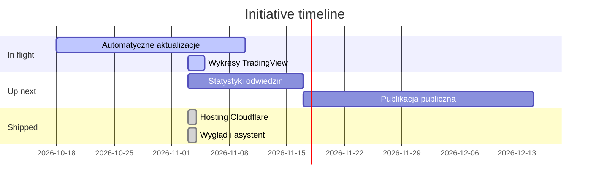
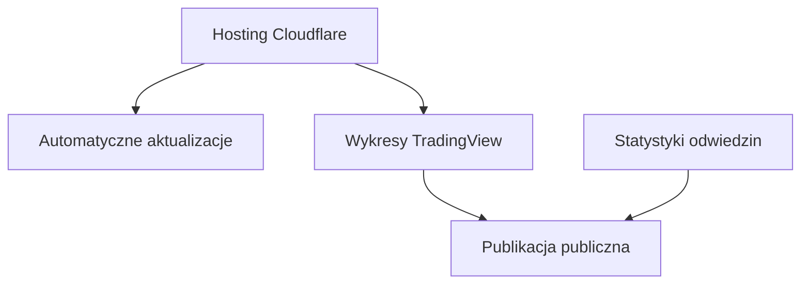

# AnalizyRynku: Project Status
*Last updated: 2026-11-03*

> Strona z analizami rynków (EUR/USD, GBP/USD, USD/JPY, USD/PLN, złoto, srebro, ropa WTI, Nasdaq 100, S&P 500, DAX, bitcoin) z poziomami, scenariuszami i rozliczaną trafnością. Claude aktualizuje ją przed każdą sesją; wersja próbna działa za hasłem na oxku.pages.dev.

---

<!-- AUTO-GENERATED from plans/plans.json. Edit plans/*.md frontmatter, not this section. -->

## At a glance

| In flight | Up next | Shipped (30d) |
| --- | --- | --- |
| 2 | 2 | 2 |

## Roadmap at a glance

## Cross-plan dependencies

## In flight: what we're working on now

| Initiative | Status | Progress | Owner | ETA | Plan |
| --- | --- | --- | --- | --- | --- |
| Automatyczne aktualizacje przed sesjami | In progress | Phase 2 of 3 | Claude + Bartek | 2026-11-10 | [AUTOMATYCZNE_AKTUALIZACJE.md](active/AUTOMATYCZNE_AKTUALIZACJE.md) |
| Wykresy TradingView na żywej stronie | Blocked | Phase 1 of 2 | Claude + Bartek | 2026-11-05 | [WERYFIKACJA_TRADINGVIEW.md](active/WERYFIKACJA_TRADINGVIEW.md) |

## Up next: committed for next 30 days

| Initiative | Why it matters | Effort | Depends on | Plan |
| --- | --- | --- | --- | --- |
| Statystyki odwiedzin (GoatCounter) | Wiemy, ile osób czyta analizy, bez plików cookie | S | kod od Bartka | [STATYSTYKI_ODWIEDZIN.md](active/STATYSTYKI_ODWIEDZIN.md) |
| Publikacja publiczna strony | Strona dostępna dla wszystkich | M | TradingView, statystyki, zgoda Bartka | [PUBLIKACJA_PUBLICZNA.md](active/PUBLIKACJA_PUBLICZNA.md) |

<!-- END AUTO-GENERATED -->

---

## Recently shipped: last 30 days

| What | Shipped | Commit | Why it mattered |
| --- | --- | --- | --- |
| Przeniesienie na Cloudflare Pages | 2026-11-03 | cc8c20e | Netlify przestał aktualizować stronę po wyczerpaniu kredytów |
| Poprawki wyglądu i darmowy asystent | 2026-11-03 | 1fa209e | Tablet bez przewijania w bok, asystent odpowiada na więcej pytań |

## Monthly log: append-only history

### 2026-10

- Strona, 11 instrumentów, przeglądy rano i wieczorem, kalendarz, rozliczanie analiz, wykresy poziomów, hasło.

### 2026-11

- Przeniesienie na Cloudflare Pages, trzecia aktualizacja dziennie (przed USA), poprawki tabletu, rozbudowany asystent, plany w /plans.

---

## Backlog / ideas: captured, not committed

- **Jednolite formatowanie liczb w tabelach:** 4000 vs 28 300, WTI 105,00; drobna poprawka z przeglądu wyglądu.
- **Analiza trafności:** przy 46% (12 z 26) sprawdzić, które instrumenty i nastawienia zawodzą najczęściej.
- **Newsletter lub powiadomienia:** dopiero po wyborze usługi i zgodzie Bartka.

## Blocked / risks

| Item | Blocked on | Action needed | Since |
| --- | --- | --- | --- |
| Stary projekt Netlify | Bartek | Usunąć projekt w panelu Netlify, żeby nie zbudował strony bez hasła | 2026-11-03 |
| Wykresy TradingView | Bartek | Sprawdzić wykres po kliknięciu Akceptuję | 2026-11-03 |
| GoatCounter | Bartek | Podać kod strony | 2026-10 |
